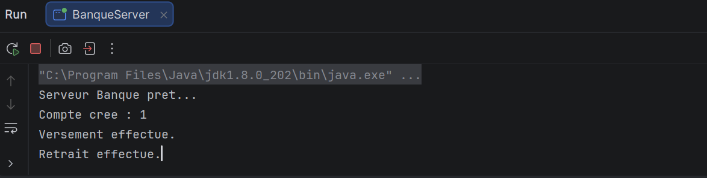
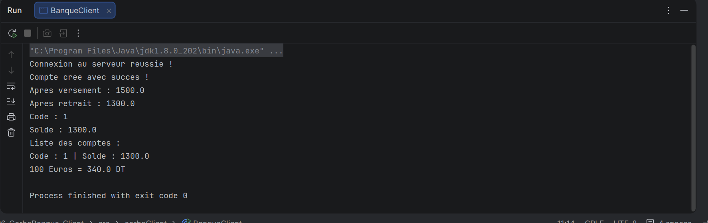

# TP6 – Communication Client-Serveur avec CORBA

**Étudiante/Étudiant :** Rayen Adsi  
**Module :** Développement d'Applications Réparties  
**TP :** TP6 – Implémentation des communications Client-Serveur via CORBA

---

## 1. Objectif du TP

L'objectif de ce TP est de développer une application distribuée en Java en utilisant le middleware CORBA (Common Object Request Broker Architecture).

L'application consiste à mettre en place un service bancaire permettant aux clients de communiquer à distance avec un serveur qui gère les comptes bancaires.

## 2. Environnement de développement

- Java JDK 8
- IntelliJ IDEA
- CORBA
- Java IDL Compiler (`idlj`)
- Git et GitHub

## 3. Structure du projet

Le TP est organisé en deux projets Java indépendants :

### Projet Serveur : TP6_CorbaBanque_Server

- `Banque.idl` : définition de l'interface du service bancaire.
- `jndi.properties` : configuration de l'annuaire JNDI.
- `corbaBanque` : classes générées automatiquement à partir du fichier IDL.
- `service/BanqueImpl.java` : implémentation des méthodes du service bancaire.
- `corbaServer/BanqueServer.java` : initialisation et lancement du serveur CORBA.

### Projet Client : TP6_CorbaBanque_Client

- `Banque.idl` : définition de l'interface distante.
- `jndi.properties` : configuration de l'annuaire.
- `corbaBanque` : classes générées pour le client.
- `corbaClient/BanqueClient.java` : application cliente qui invoque les méthodes distantes.

## 4. Fonctionnalités réalisées

Le serveur bancaire permet d'effectuer les opérations suivantes :

- Création d'un compte bancaire avec un solde initial.
- Versement d'une somme sur un compte.
- Retrait d'une somme d'un compte.
- Consultation d'un compte bancaire.
- Consultation de la liste de tous les comptes.
- Conversion d'un montant en euros vers le dinar tunisien.

## 5. Exécution de l'application

L'exécution nécessite de respecter l'ordre suivant :

**Étape 1 : Lancement du Naming Service**

```bash
tnameserv -ORBInitialPort 900
```

**Étape 2 : Lancement du serveur**

Exécuter la classe `BanqueServer.java` dans le projet serveur.

**Étape 3 : Lancement du client**

Exécuter la classe `BanqueClient.java` dans le projet client.

Le client récupère la référence de l'objet distant à partir de l'annuaire JNDI et utilise le Stub CORBA pour appeler les méthodes du serveur.

## 6. Captures d'écran

### 6.1 Exécution du serveur

La capture suivante présente le lancement du serveur bancaire CORBA.



### 6.2 Exécution du client

La capture suivante présente l'exécution du client et les opérations bancaires effectuées à distance.



## 7. Conclusion

Ce TP nous a permis de comprendre et de mettre en pratique la communication entre applications distribuées en utilisant CORBA.

Nous avons appris à définir une interface distante avec IDL, à générer les classes nécessaires, à implémenter un serveur bancaire et à développer un client capable d'invoquer les méthodes distantes à travers le middleware CORBA.
